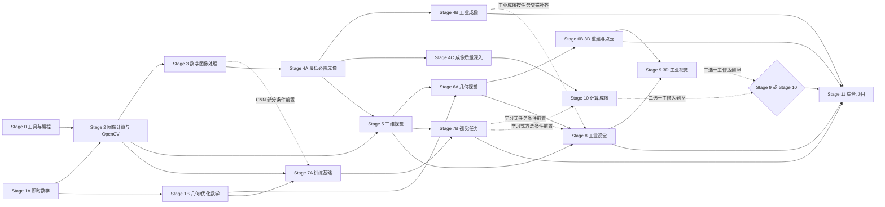

# 私人机器视觉 Learning OS：三年学习路线

> 面向光电信息科学与工程本科生、机器视觉与编程零基础。目标不是“看完课程”，而是在三年内逐步形成 **光学成像（Optical Imaging）+ 图像处理（Image Processing）+ 计算机视觉（Computer Vision）+ 3D 视觉（3D Vision）+ 工业工程（Industrial Engineering）** 的可验证复合能力。

## 1. 如何使用这份路线

### 1.1 路线不是线性清单

Stage 0–11 是稳定的内容分类，不表示必须按编号串行学完。实际执行顺序由 `hard` 依赖子图构成的有向无环图（Directed Acyclic Graph, DAG）决定：

图中的实线表示公共主干或无条件方向，虚线表示只对相应任务生效的条件前置。`ADV` 是 OR 门槛：Stage 9 与 Stage 10 至少一条达到 M，不要求两条同时达到 M。

等价的文字规则是：

- 先取得 Stage 0 的最低编程门槛，再用 Stage 2 尽快操作真实图像。
- Stage 1 不整段前置；数学概念在第一次被视觉任务需要之前学习。图中的 S1A 指 `math.vectors-matrices`, `math.linear-transforms`, `math.calculus-gradients`, `math.probability-statistics`；S1B 指 `math.coordinate-frames`, `math.least-squares`, `math.eigen-svd`, `math.optimization`, `math.numerical-stability`，`math.lie-groups` 始终为 A 级选修。
- Stage 4 分为最低必需成像、工业成像和高级成像质量三次回访，不让完整光学理论阻塞实践。
- Stage 7A 的张量、自动微分和训练基础可在 Stage 2 与必要数学后并行启动，CNN 部分再补 Stage 3 的卷积；Stage 7B 的数据、评价、分类、检测和分割任务在 Stage 5 的任务定义与评价基础后进入。两组稳定 ID 见 9.2 节。深度学习不是经典多视图几何（Multi-view Geometry）的前置条件。
- Stage 8 的系统意识从早期项目开始，完整工业集成在二维视觉和成像基础之后进行。
- Stage 9 与 Stage 10 是两条高级主修支线；三年内至少精通一条，另一条先达到理解层。
- Stage 11 的项目证据贯穿三年，不是学完前十阶段后才开始。

### 1.2 节点、前置与深度语义

每个知识簇使用稳定语义 ID。ID 一旦被学习记录引用，不因标题润色或阶段内排序而改变。

| 字段 | 含义 |
|---|---|
| `hard` | 硬前置。前置节点至少达到 `understood` 后，推荐器才把该节点列为可执行主任务；未达到时应先补前置。 |
| `recommended` | 推荐前置。允许并行补齐，但缺失时应降低任务难度或先看直觉解释。 |
| `M`（Master） | 必须掌握：能独立应用、解释关键选择、诊断常见错误，并产生可检查结果。 |
| `U`（Understand） | 理解即可：能说明用途、读懂结果并在文档帮助下正确使用。 |
| `A`（Advanced） | 后期深入：当前知道何时需要即可，固定视为选修，不进入公共主干进度分母。 |

路线目标状态统一为：M 节点达到 `mastered`；U 节点达到 `understood` 或 `mastered`；A 节点默认达到 `understood` 即完成当前选修探索，但不参与公共阶段通过。项目若通过 `minimumStatus` 要求更高状态，以项目要求为准。

只有 `hard` 子图参与拓扑顺序和环检测。`recommended` 可表达交错学习中的互相参照，不阻塞开始，也不参与拓扑排序；但仍禁止自依赖、重复边和引用不存在的 ID。

### 1.3 统一完成规则

知识节点只有在其全部必需掌握标准都被“通过”的有效证据覆盖，并由用户手动确认后，才可标记为“已掌握”。同一证据可以覆盖多个标准，也可以由多项证据共同覆盖；证据形式至少支持：

1. 从空白文件独立实现一个最小实验，并解释输入、输出和失败条件；
2. 对同一问题比较至少两种方法，用合适指标和失败样例说明取舍；
3. 完成一个项目子任务，结果可复现，并保留代码、参数、数据说明和结论；
4. 对硬件或成像问题完成受控实验，改变一个变量并记录可解释的结果。

复制教程、只运行现成 Notebook、只观看视频或只背诵定义，均不构成掌握证据。

### 1.4 工时口径

- 默认投入：每周 8–10 小时，每年 40–44 个有效学习周，三年约 960–1320 小时。
- 阶段工时包含概念学习、练习、复盘及关联项目在该阶段的份额；项目表中的工时不是额外重复相加。
- `A` 级深入内容不计入公共主干的基础工时。
- 工时是范围而非截止日期；能否通过出口标准比“用了几周”更重要。

### 1.5 关联项目与阶段门槛

章节中的“关联项目”只说明该阶段会为项目贡献知识或证据，不等于必须完成其列出的所有项目。项目门槛只取下表的 `projectGates`；项目中间版本可以作为出口标准证据，但不提前把整个项目标为完成。

稳定 Track ID 固定为公共主干 `track.common`、3D 工业分支 `track.industrial-3d` 与计算成像分支 `track.computational-imaging`。默认路线把前者设为 `master`、后两者分别设为 `master` 和 `understand`；交换高级主次时只交换两个高级 Track 的目标，不修改内容 ID 或既有证据。

| 永久 checkpoint ID | 显示名 | 分类 | `entryGate` | `projectGates` | `categoryExitForTrackIds` | `retestAfterDays` |
|---|---|---:|---|---|---|---:|
| `stage.tooling-foundations` | Stage 0 | 0 | — | —；Pixel Lab 最小版本仅作出口证据 | `track.common` | 7 |
| `stage.vision-math-immediate` | Stage 1A | 1 | — | — | — | — |
| `stage.vision-math-geometry-optimization` | Stage 1B | 1 | — | `project.math-vision-lab` | `track.common` | 7 |
| `stage.image-computing` | Stage 2 | 2 | — | `project.pixel-lab`；Classical Inspection v1 仅作出口证据 | `track.common` | 7 |
| `stage.digital-image-processing` | Stage 3 | 3 | — | `project.classical-inspection` | `track.common` | 7 |
| `stage.imaging-foundations` | Stage 4A | 4 | — | —；Imaging Quality Lab 最小版本仅作出口证据 | — | — |
| `stage.industrial-imaging` | Stage 4B | 4 | `stage.imaging-foundations` | `project.imaging-quality-lab` | `track.common` | 7 |
| `stage.imaging-quality-advanced` | Stage 4C | 4 | `stage.imaging-foundations` | —；PSF/MTF 证据作为出口 | `track.computational-imaging` | 7 |
| `stage.planar-vision` | Stage 5 | 5 | `stage.imaging-foundations` | `project.planar-localization` | `track.common` | 7 |
| `stage.geometric-vision` | Stage 6A | 6 | — | `project.calibrated-metrology`, `project.stereo-or-pnp` | — | — |
| `stage.depth-reconstruction` | Stage 6B | 6 | `stage.geometric-vision` | `project.pointcloud-measurement` | `track.common` | 7 |
| `stage.deep-learning-foundations` | Stage 7A | 7 | — | — | — | — |
| `stage.modern-vision-tasks` | Stage 7B | 7 | `stage.deep-learning-foundations` | `project.learning-defect-inspection` | `track.common` | 7 |
| `stage.industrial-vision` | Stage 8 | 8 | — | `project.industrial-vision-system` | `track.common` | 7 |
| `stage.industrial-3d` | Stage 9 | 9 | `allOf(stage.depth-reconstruction, stage.industrial-vision)` | `project.industrial-3d-system`，仅当 `track.industrial-3d = master` | `track.industrial-3d` | 7 |
| `stage.computational-imaging` | Stage 10 | 10 | `stage.imaging-quality-advanced` | `project.optics-algorithm`，仅当 `track.computational-imaging = master` | `track.computational-imaging` | 7 |
| `stage.capstone` | Stage 11 | 11 | 公共 Stage 0–8 分类出口 `allOf`，再加 Stage 9/10 主修 checkpoint `anyOf` | `project.capstone` | `track.common` | 7 |

`entryGate` 引用的是 checkpoint 的完整通过状态，不可用若干相关概念已理解来替代其项目、出口证据或复测。Stage 11 的公共 `allOf` 精确包含表中 `track.common` 的九个分类出口，高级 `anyOf` 的两个 leaf 还分别要求对应 Track 当前目标为 `master`；完整永久 ID 展开与 `ARCHITECTURE.md` 一致。

Stage 1B 有意不设置阶段级 `entryGate`：Stage 1 采用即时、交错学习，坐标系可以在概率统计与梯度全部掌握前按任务进入。Stage 1B 内每个 Concept 仍必须满足第 3.1 节声明的自身 `hard` 前置；移除整段 checkpoint 门槛不表示可以绕过这些知识依赖。Stage 1A checkpoint 继续独立记录该子阶段的完整能力证据。

checkpoint catalog 使用 `contentStatus` 记录正式内容成熟度：当前 `stage.tooling-foundations`、`stage.vision-math-immediate` 与 `stage.vision-math-geometry-optimization` 为 `available`；其余 checkpoint 为 `planned`，直到真实 Concept 经 schema 与引用校验后发布。Stage 1B 当前已发布五个必修 Concept，其中包括 `math.numerical-stability`；A 级选修 `math.lie-groups` 仍未发布。`available` 不表示规划节点已全部发布，也不表示 Stage 1B 的项目、出口证据与复测已经完成。`planned` 不影响路线 ID、入口门槛或出口证据的正式性，也不允许用占位 Concept 伪造课程覆盖。

---

## 2. Stage 0：计算机与编程基础

**目标：** 建立可复现的机器视觉实验能力，能独立创建环境、运行脚本、组织小项目、调试常见错误并记录版本。

**进入条件：** 无。

**估算工时：** 35–45 小时。

**关联项目：** `project.pixel-lab`。

### 2.1 核心知识簇

| 稳定 ID | 知识簇 | 深度 | hard | recommended | 掌握证据 |
|---|---|---:|---|---|---|
| `tooling.computer-files` | 文件、路径、进程与终端（Files, Paths, Processes, Shell） | M | — | — | 能从终端定位目录、创建项目结构、使用相对/绝对路径，并解释当前工作目录。 |
| `tooling.python-core` | Python 基础语法与数据结构（Python Core） | M | — | `tooling.computer-files` | 独立写出包含分支、循环、函数、列表和字典的数据处理脚本。 |
| `tooling.python-modules` | 函数、模块、异常与文件 I/O（Modules, Exceptions, File I/O） | M | `tooling.python-core` | — | 将单文件脚本拆成可导入模块，处理无效路径和错误输入。 |
| `tooling.dev-environment` | VS Code、Python 解释器、虚拟环境与依赖（Virtual Environment, pip/uv） | M | `tooling.computer-files` | `tooling.python-core` | 从空目录创建隔离环境，安装依赖并在新终端中重现运行。 |
| `tooling.git-basics` | Git 与 GitHub 基础（Version Control） | M | `tooling.computer-files` | `tooling.python-modules` | 完成初始化、分支、提交、差异检查和一次可解释的冲突处理演练。 |
| `tooling.debugging` | 调试、日志、断点与最小复现（Debugging） | M | `tooling.python-core` | `tooling.dev-environment` | 用断点或日志定位一个维度、类型或路径错误，写出原因和修复。 |
| `tooling.linux-basics` | Linux 与命令行基础（Linux Basics） | U | `tooling.computer-files` | — | 在可用的 Linux/WSL 环境中完成导航、文件操作、运行 Python 和查看进程；无环境时用命令对照练习。 |
| `tooling.reproducibility` | README、依赖锁定、配置和随机种子（Reproducibility） | M | `tooling.python-modules`, `tooling.git-basics` | `tooling.debugging` | 让另一环境仅根据 README 和依赖文件复现实验结果。 |

### 2.2 可执行学习单元

| 单元 | 对应节点 | 建议工时 | 完成物 |
|---|---|---:|---|
| S0-U1 认识工作区 | `tooling.computer-files` | 3–4 h | 一张路径/进程/解释器关系图；终端操作记录。 |
| S0-U2 建立 Python 工作环境 | `tooling.dev-environment` | 4–5 h | 独立虚拟环境、依赖清单、可运行的 `hello_vision` 脚本。 |
| S0-U3 Python 最小语言集 | `tooling.python-core` | 8–10 h | 三个短练习：统计列表、筛选记录、批量重命名计划的只读预览。 |
| S0-U4 写成小程序 | `tooling.python-modules` | 6–8 h | 带函数、命令行参数、异常提示和文件 I/O 的脚本。 |
| S0-U5 版本控制 | `tooling.git-basics` | 4–5 h | 至少 5 次语义清楚的提交，以及一次分支合并演练。 |
| S0-U6 调试训练 | `tooling.debugging` | 4–5 h | 三个故障卡片：现象、最小复现、根因、修复、预防。 |
| S0-U7 可复现交付 | `tooling.reproducibility`, `tooling.linux-basics` | 5–8 h | README、运行说明、依赖文件；在新终端重跑。 |

### 2.3 本周启动计划（8–10 小时）

| 学习块 | 时间 | 本周动作 | 当次验收 |
|---|---:|---|---|
| A | 1.5 h | 认识文件、终端、解释器与工作目录；从终端运行一个 Python 文件。 | 能解释“脚本路径”和“当前工作目录”为什么不同。 |
| B | 2 h | 创建隔离环境，安装后续将使用的 NumPy、Matplotlib、OpenCV；记录版本。 | 关闭终端后重新激活环境并成功导入依赖。 |
| C | 2 h | 学习变量、列表、字典、循环和函数，完成两道小数据处理练习。 | 不复制答案，能口头解释每个函数的输入和返回值。 |
| D | 2 h | 使用示例代码读取一张自摄图片、打印尺寸和类型、保存副本；此时不要求理解像素数组细节。 | 输入路径错误时能给出清楚提示；输出文件可打开。 |
| E | 1.5–2.5 h | 初始化 Git，完成 3 次小提交，写一页学习日志。 | 从空终端根据自己的 README 重跑脚本。 |

**本周完成定义：** 环境可重建、脚本可运行、失败信息可理解、Git 有清晰历史。若未通过，不扩展新库或新工具，先修复可复现性。

### 2.4 阶段出口标准

- 能在 30 分钟内从空目录建立隔离环境并运行一个读取图像的 Python 程序。
- 能解释路径、解释器、包、模块和进程之间的关系。
- 能用 Git 保存小步修改，并从差异中判断自己改了什么。
- 能独立定位至少一个路径错误、一个 Python 异常和一个依赖/解释器错误。
- `project.pixel-lab` 的环境与最小程序可由 README 重现。

---

## 3. Stage 1：面向视觉的数学基础

**目标：** 获得读懂、实现和检查视觉算法所需的数学语言；采用即时学习（Just-in-time Learning），不把整门大学数学课作为实践前置。

**进入条件：** `tooling.python-core`。数学手算可以先行，数值实验需要 `python.numpy-arrays`。

**估算工时：** 70–90 小时，分散在第一、二年按依赖回访。

**关联项目：** `project.math-vision-lab`，并为后续所有几何、成像和深度学习项目提供工具。

### 3.1 核心知识簇

| 稳定 ID | 知识簇 | 深度 | hard | recommended | 掌握证据 |
|---|---|---:|---|---|---|
| `math.vectors-matrices` | 向量、矩阵与基本运算（Vectors & Matrices） | M | `tooling.python-core` | `python.numpy-arrays` | 用手算和 NumPy 计算点积、矩阵乘法、转置与逆，并检查形状和几何含义。 |
| `math.linear-transforms` | 线性变换、基与秩（Linear Transforms, Basis, Rank） | M | `math.vectors-matrices` | — | 可视化二维缩放、旋转、剪切，解释秩亏对信息的影响。 |
| `math.coordinate-frames` | 坐标系、基变换与齐次思想（Coordinate Frames） | M | `math.linear-transforms` | — | 在两个坐标系间往返变换一组点，并用数值误差验证闭环。 |
| `math.least-squares` | 最小二乘与残差（Least Squares, Residuals） | M | `math.vectors-matrices` | `math.probability-statistics` | 拟合直线或平面，报告残差并解释异常点为何破坏结果。 |
| `math.eigen-svd` | 特征值、特征向量与奇异值分解（Eigenvalues, SVD） | M | `math.linear-transforms` | `math.least-squares` | 用 SVD 完成低秩近似或 PCA 小实验，解释奇异值大小。 |
| `math.calculus-gradients` | 微积分、偏导、链式法则与梯度（Calculus & Gradients） | M | `tooling.python-core` | `math.vectors-matrices` | 对简单损失手推梯度，并用有限差分做数值梯度检查。 |
| `math.probability-statistics` | 概率、分布、均值方差与抽样（Probability & Statistics） | M | `tooling.python-core` | `python.numpy-arrays` | 模拟高斯噪声，比较样本统计量并说明训练/测试划分的不确定性。 |
| `math.optimization` | 优化、梯度下降与正则化（Optimization & Regularization） | M | `math.calculus-gradients`, `math.least-squares` | `math.probability-statistics` | 实现一个小型梯度下降并比较学习率与正则化对结果的影响。 |
| `math.numerical-stability` | 数值稳定性、条件数与误差传播（Numerical Stability） | U | `math.least-squares`, `math.eigen-svd` | `math.probability-statistics` | 构造病态问题，说明为何缩放、归一化和直接求逆可能影响结果。 |
| `math.lie-groups` | 李群/李代数中的旋转与位姿（Lie Groups, SE(3)） | A | `geometry.rigid-transforms`, `math.calculus-gradients` | `math.optimization` | 后期能读懂位姿增量和局部参数化；不作为首个 3D 项目闸门。 |

### 3.2 可执行学习单元

| 单元 | 首次安排时机 | 对应节点 | 建议工时 | 完成物 |
|---|---|---|---:|---|
| S1-U1 向量与图像数组 | Stage 2 开始前 | `math.vectors-matrices` | 8–10 h | 向量/矩阵运算 Notebook，包含形状检查和几何图示。 |
| S1-U2 变换与坐标 | 几何变换前 | `math.linear-transforms`, `math.coordinate-frames` | 10–12 h | 二维变换交互实验和坐标往返误差报告。 |
| S1-U3 导数与梯度 | 滤波优化或 Stage 7 前 | `math.calculus-gradients` | 9–11 h | 手推 + 数值梯度检查。 |
| S1-U4 概率统计 | 噪声、评价指标前 | `math.probability-statistics` | 8–10 h | 噪声采样和置信性小实验。 |
| S1-U5 最小二乘 | Homography/标定前 | `math.least-squares` | 8–10 h | 含离群点的直线拟合与残差图。 |
| S1-U6 特征分解 | PCA、标定、点云前 | `math.eigen-svd` | 8–10 h | 图像低秩近似或二维 PCA。 |
| S1-U7 优化与正则化 | 深度学习、BA 前 | `math.optimization` | 9–12 h | 学习率和正则化对照实验。 |
| S1-U8 数值可靠性 | 标定、重建前 | `math.numerical-stability` | 6–8 h | 病态矩阵与归一化实验卡片。 |

### 3.3 阶段项目

`project.math-vision-lab` 不是一次性大作业，而是持续扩展的数学实验册。每个章节必须包含：视觉问题、几何直觉、最小数学形式、数值实验、检查方法和一个常见误区。第一年完成矩阵变换、最小二乘和噪声三章；第二年补 SVD、梯度和优化。

### 3.4 阶段出口标准

- 能根据视觉问题写出向量/矩阵的形状，并在代码运行前检查乘法是否合法。
- 能区分坐标点、方向向量、坐标系和变换，完成往返验证。
- 能用残差、均值方差和数值检查判断结果是否可信。
- 能解释最小二乘、SVD、梯度分别为何会出现在标定、重建和训练中。
- 不要求完成所有严密证明；但不得在不理解维度、单位和坐标系时直接套公式。

---

## 4. Stage 2：Python 科学计算与 OpenCV 图像实验

**目标：** 把图像视为带有类型、形状、通道和坐标约定的数值数据，能构建可重复、可检查的二维图像处理流水线。

**进入条件：** `tooling.dev-environment`, `tooling.python-core`, `math.vectors-matrices`。

**估算工时：** 60–75 小时。

**关联项目：** `project.classical-inspection`；`project.pixel-lab` 在本阶段完成。

### 4.1 核心知识簇

| 稳定 ID | 知识簇 | 深度 | hard | recommended | 掌握证据 |
|---|---|---:|---|---|---|
| `python.numpy-arrays` | NumPy 数组、轴、切片与广播（Arrays, Axes, Broadcasting） | M | `tooling.python-core`, `math.vectors-matrices` | `tooling.debugging` | 不使用像素级 Python 循环完成裁剪、归一化、掩膜和通道运算，并解释每个轴。 |
| `python.numpy-dtypes` | 数据类型、溢出、复制与视图（Dtype, Overflow, Copy/View） | M | `python.numpy-arrays` | — | 构造 `uint8` 溢出和视图联动案例，给出安全转换方案。 |
| `visualization.image-plots` | Matplotlib 图像、曲线与直方图（Visualization） | M | `python.numpy-arrays` | — | 在一张报告图中正确展示原图、处理结果、直方图和必要单位。 |
| `image.digital-representation` | 像素、分辨率、坐标、通道与灰度（Digital Image Representation） | M | `python.numpy-arrays` | `math.coordinate-frames` | 对任意输入打印并解释尺寸、类型、通道顺序、数值范围和坐标原点。 |
| `opencv.io-color` | 图像读写与色彩空间（Image I/O & Color Spaces） | M | `image.digital-representation`, `tooling.python-modules` | `visualization.image-plots` | 正确处理 BGR/RGB、灰度和透明通道，读取失败时显式报错。 |
| `opencv.roi-masks` | 感兴趣区域与掩膜（ROI & Masks） | M | `python.numpy-arrays`, `opencv.io-color` | — | 用几何 ROI 和二值掩膜提取目标区域，不改变原图。 |
| `opencv.geometric-transforms` | 缩放、旋转、仿射与透视变换（Geometric Transforms） | M | `math.linear-transforms`, `opencv.io-color` | `math.coordinate-frames` | 对已知点完成图像变换并可视化插值与边界差异。 |
| `opencv.filtering-basics` | 平滑、锐化与基础滤波（Filtering） | M | `python.numpy-arrays`, `opencv.io-color` | `dip.convolution-lsi` | 比较至少两种滤波器对噪声和边缘的影响。 |
| `opencv.threshold-morphology` | 阈值与形态学（Thresholding & Morphology） | M | `opencv.io-color`, `opencv.roi-masks` | `dip.morphology` | 通过受控参数得到稳定二值目标，并解释核大小的影响。 |
| `opencv.edges-contours` | 边缘、轮廓与区域测量（Edges & Contours） | M | `opencv.filtering-basics`, `opencv.threshold-morphology` | `dip.segmentation` | 提取目标轮廓，计算面积/外接框，并过滤明显伪目标。 |
| `pipeline.batch-images` | 批处理、配置、结果保存与日志（Batch Pipeline） | M | `tooling.reproducibility`, `opencv.edges-contours` | `tooling.debugging` | 对一组图片批量运行，保存参数、结果和失败清单，不静默跳过错误。 |
| `opencv.features-preview` | 局部特征预览（Feature Preview） | U | `opencv.edges-contours` | `dip.feature-representation` | 能调用并可视化一个角点或关键点检测器；原理留到 Stage 5。 |

### 4.2 可执行学习单元

| 单元 | 对应节点 | 建议工时 | 完成物 |
|---|---|---:|---|
| S2-U1 数组就是图像数据 | `python.numpy-arrays`, `python.numpy-dtypes` | 10–12 h | 数组形状、广播、切片、溢出和 copy/view 实验。 |
| S2-U2 正确看见结果 | `visualization.image-plots`, `image.digital-representation` | 5–7 h | 标注通道、范围和单位的对照图。 |
| S2-U3 图像 I/O 与颜色 | `opencv.io-color` | 6–7 h | 批量读取与色彩转换脚本，包含坏文件处理。 |
| S2-U4 ROI 与掩膜 | `opencv.roi-masks` | 4–5 h | 三种 ROI/Mask 选择方式的对照实验。 |
| S2-U5 几何变换 | `opencv.geometric-transforms` | 6–8 h | 旋转、仿射和透视校正文档图片。 |
| S2-U6 滤波入门 | `opencv.filtering-basics` | 6–8 h | 平滑/锐化对噪声和边缘影响报告。 |
| S2-U7 阈值与形态学 | `opencv.threshold-morphology` | 7–9 h | 至少三种照明条件下的二值化失败分析。 |
| S2-U8 边缘、轮廓与测量 | `opencv.edges-contours` | 7–9 h | 面积、周长、外接框与目标筛选结果。 |
| S2-U9 批处理项目 | `pipeline.batch-images`, `opencv.features-preview` | 9–12 h | 可配置批处理程序、汇总表、失败样例和 README。 |

### 4.3 阶段项目

`project.classical-inspection`：对一组零件、瓶盖、硬币或打印图形完成前景分割、形态学清理、轮廓筛选和规则判定。手机或普通摄像头即可采集；没有稳定拍摄条件时使用自制几何图像或公开静态图片。此阶段只做像素/轮廓层面的相对测量，不宣称真实尺寸精度。

### 4.4 阶段出口标准

- 面对陌生图片，先检查路径、形状、类型、通道、范围和方向，再选择处理方法。
- 能解释至少三类常见错误：BGR/RGB 混淆、`uint8` 溢出、宽高/行列/坐标混淆。
- 能把交互式试验整理为批处理程序，参数、输入、输出和失败均可追踪。
- `project.classical-inspection` 在未见过的测试图片上运行，并保留成功与失败样例。
- 能明确区分“视觉上看起来不错”和“用指标或规则验证过”。

---

## 5. Stage 3：数字图像处理

**目标：** 理解数字图像为何会失真、如何在空间域和频率域处理，以及如何根据噪声、边缘和任务指标选择方法。

**进入条件：** `python.numpy-arrays`, `opencv.filtering-basics`, `math.vectors-matrices`。

**估算工时：** 65–85 小时。

**关联项目：** `project.classical-inspection`, `project.imaging-quality-lab`。

### 5.1 核心知识簇

| 稳定 ID | 知识簇 | 深度 | hard | recommended | 掌握证据 |
|---|---|---:|---|---|---|
| `dip.sampling-quantization` | 采样、量化与混叠（Sampling, Quantization, Aliasing） | M | `image.digital-representation` | `math.linear-transforms` | 通过降采样实验展示混叠，并比较合适的预滤波。 |
| `dip.convolution-lsi` | 卷积与线性移不变系统（Convolution, LSI） | M | `math.vectors-matrices`, `python.numpy-arrays` | `math.linear-transforms` | 手工实现小核卷积并与库函数比较边界和数值差异。 |
| `dip.noise-models` | 高斯、散粒、脉冲与读出噪声（Noise Models） | M | `math.probability-statistics`, `image.digital-representation` | `sensor.noise-snr` | 模拟不同噪声并用统计量区分，不把所有噪点都称为高斯噪声。 |
| `dip.spatial-filtering` | 空域平滑、锐化与边缘保持（Spatial Filtering） | M | `dip.convolution-lsi`, `dip.noise-models` | `opencv.filtering-basics` | 根据噪声和边缘指标比较均值、高斯、中值及一种边缘保持方法。 |
| `dip.frequency-domain` | 傅里叶变换与频域滤波（Fourier Transform） | M | `dip.convolution-lsi`, `math.vectors-matrices` | `math.calculus-gradients` | 解释频谱中心、幅度和方向，完成空间/频域等价性小实验。 |
| `dip.enhancement` | 对比度、直方图与图像增强（Enhancement） | M | `visualization.image-plots`, `dip.noise-models` | `sensor.dynamic-range` | 比较全局与局部增强，识别噪声放大和过增强。 |
| `dip.restoration` | 退化模型与图像恢复（Image Restoration） | U | `dip.frequency-domain`, `dip.noise-models` | `imaging.psf-mtf` | 在已知模糊核的小实验中比较直接锐化与正则化恢复。 |
| `dip.segmentation` | 阈值、区域与基础分割（Segmentation） | M | `dip.spatial-filtering`, `dip.enhancement` | `math.probability-statistics` | 为一个任务定义分割真值和指标，分析不同方法的漏检/误检。 |
| `dip.morphology` | 二值与灰度形态学（Morphology） | M | `dip.segmentation` | `opencv.threshold-morphology` | 解释结构元素与目标尺度的关系，避免用大核掩盖采集问题。 |
| `dip.edge-detection` | 梯度、Canny 与边缘定位（Edge Detection） | M | `dip.convolution-lsi`, `math.calculus-gradients` | `dip.noise-models` | 比较阈值和噪声对边缘完整性、定位和伪边缘的影响。 |
| `dip.feature-representation` | 形状、纹理与局部描述（Feature Representation） | U | `dip.edge-detection`, `dip.frequency-domain` | `math.eigen-svd` | 针对一个分类/匹配任务构造简单形状或纹理特征并说明局限。 |
| `dip.quality-metrics` | 图像与任务质量指标（Image/Task Quality Metrics） | M | `math.probability-statistics`, `dip.noise-models` | `cv.evaluation-basics` | 同时使用图像级和任务级指标，说明二者可能不一致。 |

### 5.2 阶段项目与出口标准

**项目：** 在 `project.classical-inspection` 中增加受控噪声、模糊、亮度和参数变化；给出至少两种处理方案、固定测试集、指标和失败分析。

**出口标准：**

- 能用采样、卷积、噪声和频率解释常见图像现象，而不是只罗列函数名。
- 能根据任务指标选择滤波、增强、分割和形态学方法，并说明副作用。
- 能设计公平对照：固定数据、只改变一个因素、保存参数和随机种子。
- 能指出算法无法弥补的采集问题，并将其交给 Stage 4 的成像设计处理。

---

## 6. Stage 4：光学成像基础与成像链

**目标：** 建立“物理世界 → 照明 → 镜头 → 传感器 → 数字图像 → 算法”的完整因果链，把光电背景转化为采集设计和误差诊断能力。

**进入条件：** 4A 需要 `image.digital-representation`, `dip.sampling-quantization`；4B 需要 4A；4C 需要 `dip.frequency-domain`, `dip.noise-models`。

**估算工时：** 75–105 小时，分三次回访；第一年只安排 4A 与部分 4B，约 35–45 小时。

**关联项目：** `project.imaging-quality-lab`, `project.calibrated-metrology`, `project.optics-algorithm`。

### 6.1 核心知识簇

| 稳定 ID | 知识簇 | 深度 | hard | recommended | 掌握证据 |
|---|---|---:|---|---|---|
| `imaging.formation-chain` | 成像链与能量/信息流（Image Formation Chain） | M | `image.digital-representation` | `dip.noise-models` | 为一张失败图像画出从物体到算法的故障树。 |
| `optics.thin-lens` | 几何光学与薄透镜（Geometric Optics, Thin Lens） | M | `math.vectors-matrices` | — | 用实际拍摄验证物距、像距和焦距变化的趋势，不要求复杂镜头设计。 |
| `optics.fov-magnification` | 焦距、视场、工作距离与放大率（FOV, Working Distance, Magnification） | M | `optics.thin-lens`, `image.digital-representation` | `math.coordinate-frames` | 为给定目标尺寸计算 FOV 和像素当量，并用拍摄结果校核。 |
| `optics.aperture-dof` | 光圈、景深与曝光权衡（Aperture, Depth of Field） | M | `optics.thin-lens` | `sensor.exposure-shutter` | 受控改变光圈或等效条件，记录清晰范围、亮度和噪声变化。 |
| `optics.aberration-diffraction` | 像差、衍射与 Airy 斑（Aberration, Diffraction, Airy Disk） | U | `optics.thin-lens` | `dip.frequency-domain` | 能区分像差、衍射、失焦和运动模糊的典型原因，不要求首年推导。 |
| `imaging.psf-mtf` | 点扩散函数、调制传递函数与分辨率（PSF, MTF, Resolution） | M | `dip.convolution-lsi`, `dip.frequency-domain` | `optics.aberration-diffraction` | 用边缘/点目标的简化实验说明分辨率不是单一像素数。 |
| `sensor.pixel-sampling` | CMOS/CCD、像素尺寸、填充与采样（Sensor & Pixel Sampling） | M | `dip.sampling-quantization` | `imaging.psf-mtf` | 判断给定光学分辨率和像素尺寸是否可能欠采样。 |
| `sensor.noise-snr` | 光子、读出噪声与信噪比（Photon/Read Noise, SNR） | M | `dip.noise-models`, `math.probability-statistics` | `imaging.formation-chain` | 用暗场/均匀场或仿真数据比较均值、方差和曝光趋势。 |
| `sensor.dynamic-range` | 动态范围、饱和与量化（Dynamic Range, Saturation） | M | `sensor.noise-snr`, `dip.sampling-quantization` | — | 设计一组曝光，标记欠曝、可用区和饱和区。 |
| `sensor.exposure-shutter` | 曝光、增益、滚动/全局快门（Exposure, Gain, Rolling/Global Shutter） | M | `imaging.formation-chain` | `sensor.noise-snr` | 用运动目标或仿真解释曝光时间、增益和形变/模糊的取舍。 |
| `optics.industrial-lenses` | 工业镜头与远心镜头（Industrial/Telecentric Lens） | U | `optics.fov-magnification`, `optics.aperture-dof` | `industrial.metrology` | 根据测量任务说明普通、低畸变和远心方案的选择理由。 |
| `illumination.geometry` | 明场、暗场、背光、同轴、偏振与颜色（Illumination Geometry） | M | `imaging.formation-chain` | `dip.enhancement` | 使用可获得光源拍摄同一目标，证明照明几何可改变缺陷可见性。 |
| `imaging.system-resolution` | 光学—传感器—算法联合分辨率（System Resolution） | M | `sensor.pixel-sampling`, `optics.fov-magnification` | `imaging.psf-mtf`, `industrial.quality-grr` | 建立系统误差预算，避免把标称像素数直接当测量精度；PSF/MTF 在 4C 继续加深。 |
| `imaging.emva1288-literacy` | 工业相机规格与 EMVA 1288 阅读能力 | U | `sensor.noise-snr`, `sensor.dynamic-range` | `industrial.camera-selection` | 从相机规格中解释灵敏度、噪声、动态范围等指标的用途和限制。 |

### 6.2 三次回访边界

- **4A 最低必需成像：** `imaging.formation-chain`, `optics.thin-lens`, `optics.fov-magnification`, `optics.aperture-dof`, `sensor.pixel-sampling`, `sensor.exposure-shutter`, `illumination.geometry`。完成后即可继续二维视觉。
- **4B 工业成像：** `sensor.noise-snr`, `sensor.dynamic-range`, `optics.industrial-lenses`, `imaging.system-resolution`, `imaging.emva1288-literacy`。第一、二年先建立基础，Stage 8 项目中按任务补齐并完成最终复测；它不是进入 Stage 8 前必须整段完成的线性门槛。
- **4C 高级成像质量：** `optics.aberration-diffraction`, `imaging.psf-mtf` 的深入实验。只作为 Stage 10 的硬前置，不阻塞 Stage 5–9。

### 6.3 阶段项目与出口标准

**项目：** `project.imaging-quality-lab`。固定场景，分别改变照明方向、曝光/增益、距离和运动条件；每次只改变一个主要变量。优先使用手机专业模式或普通摄像头；若参数不可控，使用已有照片和合成噪声/模糊完成对照，并明确哪些结论只能由仿真支持。

**出口标准：**

- 能完成一张成像设计单：目标尺寸、FOV、工作距离、像素当量、曝光、照明和主要误差源。
- 能区分失焦、运动模糊、噪声、饱和、反光和采样不足，提出优先级合理的修正方案。
- 能说明为什么“更高分辨率传感器”不自动等于“更高测量精度”。
- 能把 PSF/MTF 与卷积、频域和图像恢复建立联系，但不要求首年掌握完整光学设计。

---

## 7. Stage 5：计算机视觉基础与二维几何

**目标：** 从像素处理进入“建立对应、估计几何、抵抗离群点、跨帧跟踪”的视觉推理。

**进入条件：** `opencv.edges-contours`, `dip.edge-detection`, `math.linear-transforms`, Stage 4A。

**估算工时：** 65–85 小时。

**关联项目：** `project.planar-localization`。

### 7.1 核心知识簇

| 稳定 ID | 知识簇 | 深度 | hard | recommended | 掌握证据 |
|---|---|---:|---|---|---|
| `cv.corners-keypoints` | Harris、角点与关键点（Corners & Keypoints） | M | `dip.edge-detection` | `math.eigen-svd` | 在尺度、旋转和光照变化下比较检测稳定性。 |
| `cv.local-descriptors` | SIFT、ORB 与局部描述子（Local Descriptors） | M | `cv.corners-keypoints` | `dip.feature-representation` | 比较至少两类描述子在速度与匹配质量上的取舍。 |
| `cv.feature-matching` | 特征匹配与近邻检索（Feature Matching） | M | `cv.local-descriptors` | `math.probability-statistics` | 生成匹配可视化，并用比率/互检等规则减少明显误配。 |
| `geometry.homography` | 单应性与平面投影（Homography） | M | `cv.feature-matching`, `math.least-squares` | `math.numerical-stability` | 从对应点估计单应矩阵，检查重投影误差和退化情况。 |
| `robust.ransac` | RANSAC 与鲁棒估计（Robust Estimation） | M | `math.least-squares`, `math.probability-statistics` | `geometry.homography` | 在人工离群点下比较普通拟合和 RANSAC，报告内点率。 |
| `cv.image-stitching` | 图像配准与拼接（Registration & Stitching） | U | `geometry.homography`, `robust.ransac` | `sensor.exposure-shutter` | 完成小型拼接并分析视差、曝光和运动目标造成的失败。 |
| `cv.optical-flow` | 光流与运动估计（Optical Flow） | M | `math.calculus-gradients`, `dip.edge-detection` | `math.least-squares` | 在已知运动视频上比较稀疏/稠密结果并识别亮度恒常假设失效。 |
| `cv.tracking` | 目标跟踪与状态更新（Tracking） | M | `cv.optical-flow` | `math.probability-statistics` | 完成短视频跟踪，记录漂移、遮挡和重检测策略。 |
| `cv.task-framing` | 分类、检测、分割任务边界（Task Framing） | M | `dip.segmentation` | `cv.evaluation-basics` | 对实际问题选择正确输出形式，不把分类模型误作定位系统。 |
| `cv.evaluation-basics` | 准确率、精确率、召回率、IoU 与误差（Evaluation） | M | `math.probability-statistics` | `cv.task-framing` | 为不均衡数据选择指标并展示混淆矩阵或误差分布。 |

### 7.2 阶段项目与出口标准

**项目：** `project.planar-localization`。在书封、海报、印刷标记或平面零件上实现特征匹配、RANSAC 和平面定位；扩展项为拼接或短时跟踪。用手机/普通摄像头拍摄即可，也可使用公开图片或自行生成的透视变换图像。

**出口标准：**

- 能从“检测—描述—匹配—模型估计—验证”解释完整数据流。
- 报告匹配数、内点率、重投影误差、运行时间和至少三类失败样例。
- 知道 Homography 适用于平面或纯旋转等条件，不能把任意场景都当作平面。
- 能区分经典二维特征、现代学习式检测/分割和后续三维几何各自解决的问题。

---

## 8. Stage 6：多视图几何与 3D 视觉

**目标：** 建立从坐标系、相机投影和多视图约束到深度、位姿、点云与重建的主干能力。这是三年路线的核心模块之一。

**进入条件：** 6A 需要 `geometry.homography`, `math.coordinate-frames`, `math.least-squares`, `optics.fov-magnification`；6B 需要 6A 的标定、极几何和三角化证据。

**估算工时：** 130–180 小时。

**关联项目：** `project.calibrated-metrology`, `project.stereo-or-pnp`, `project.pointcloud-measurement`。

### 8.1 核心知识簇

| 稳定 ID | 知识簇 | 深度 | hard | recommended | 掌握证据 |
|---|---|---:|---|---|---|
| `geometry.homogeneous-coordinates` | 齐次坐标与投影空间（Homogeneous Coordinates） | M | `math.coordinate-frames` | `geometry.homography` | 正确区分点、方向和无穷远点，完成归一化与尺度检查。 |
| `geometry.rigid-transforms` | 刚体变换与坐标链（Rigid Transforms） | M | `math.coordinate-frames` | `math.numerical-stability` | 建立相机、世界、物体坐标链，并通过逆变换闭环检查。 |
| `geometry.rotation-representations` | 旋转矩阵、欧拉角、轴角与四元数（Rotations, Quaternion） | M | `geometry.rigid-transforms` | `math.eigen-svd` | 转换并验证旋转正交性，解释欧拉角奇异和四元数符号二义性。 |
| `geometry.se3` | SE(3) 位姿表示（Pose in SE(3)） | M | `geometry.rotation-representations` | `math.lie-groups` | 组合、求逆并验证多段位姿；李代数细节保持 A 级。 |
| `camera.pinhole-model` | 针孔相机与透视投影（Pinhole Camera） | M | `geometry.homogeneous-coordinates`, `optics.thin-lens` | `geometry.se3` | 从 3D 点投影到像素并解释深度、焦距和主点的影响。 |
| `camera.intrinsics-extrinsics` | 内参与外参（Intrinsics & Extrinsics） | M | `camera.pinhole-model`, `geometry.se3` | `optics.fov-magnification` | 为真实相机矩阵标注单位、坐标系和参数含义。 |
| `camera.distortion` | 径向/切向畸变与校正（Lens Distortion） | M | `camera.intrinsics-extrinsics` | `optics.aberration-diffraction` | 可视化畸变场，比较校正前后直线和边缘区域。 |
| `camera.calibration` | 张氏标定与质量检查（Zhang Calibration） | M | `camera.distortion`, `math.least-squares` | `math.numerical-stability` | 独立采集或使用替代数据完成标定，报告每图与总体重投影误差。 |
| `geometry.epipolar` | 极几何、基础矩阵与本质矩阵（Epipolar, F, E） | M | `camera.intrinsics-extrinsics`, `math.eigen-svd` | `robust.ransac` | 可视化极线并用点到极线误差检查匹配。 |
| `stereo.rectification` | 双目校正（Stereo Rectification） | M | `camera.calibration`, `geometry.epipolar` | — | 使对应点接近同一扫描线，并量化垂直视差。 |
| `geometry.triangulation` | 三角化与深度不确定性（Triangulation） | M | `geometry.epipolar`, `camera.calibration` | `math.numerical-stability` | 从多视图恢复点并分析基线、焦距和像素误差对深度的影响。 |
| `geometry.pnp` | PnP 与相机/物体位姿（Perspective-n-Point） | M | `camera.calibration`, `geometry.se3` | `robust.ransac` | 估计位姿并用重投影与坐标轴叠加验证。 |
| `geometry.bundle-adjustment` | 捆绑调整（Bundle Adjustment） | U | `geometry.triangulation`, `math.optimization` | `math.lie-groups` | 能说明优化变量、残差和规范自由度；可使用库完成小规模优化。 |
| `stereo.matching-depth` | 立体匹配、视差与深度图（Stereo Matching & Depth） | M | `stereo.rectification`, `geometry.triangulation` | `dip.quality-metrics` | 生成视差/深度图，分析遮挡、弱纹理和反光失败。 |
| `rgbd.pipeline` | RGB-D 数据、对齐与相机模型（RGB-D Pipeline） | M | `camera.intrinsics-extrinsics` | `stereo.matching-depth` | 将深度反投影到 3D，并检查无效深度和颜色对齐。 |
| `pointcloud.basics` | 点云表示、滤波、法向与分割（Point Clouds） | M | `geometry.se3`, `rgbd.pipeline` | `math.eigen-svd` | 完成下采样、离群点处理、法向估计和一个几何分割。 |
| `pointcloud.icp` | ICP 配准与初值敏感性（Iterative Closest Point） | M | `pointcloud.basics`, `math.least-squares` | `geometry.pnp` | 比较不同初值和重叠率，报告配准误差与错误收敛。 |
| `sfm.reconstruction` | 运动恢复结构与 3D 重建（SfM & Reconstruction） | U | `geometry.epipolar`, `geometry.triangulation`, `geometry.pnp` | `geometry.bundle-adjustment` | 完成小规模重建，解释尺度不确定性和累计漂移。 |
| `geometry.uncertainty` | 几何误差传播与可观测性（Uncertainty & Observability） | M | `math.probability-statistics`, `geometry.triangulation` | `math.numerical-stability` | 用仿真或重复实验展示像素误差如何传播为深度/位姿误差。 |

### 8.2 两次学习边界

- **6A 几何视觉：** 从 `geometry.homogeneous-coordinates` 到 `geometry.pnp`，重点是坐标、相机、标定、极几何、三角化和位姿。
- **6B 深度与重建：** 从 `stereo.matching-depth` 到 `sfm.reconstruction`，重点是深度图、RGB-D、点云、ICP 和重建。`geometry.bundle-adjustment` 先达到 U，再按科研需要深入。

### 8.3 阶段项目与出口标准

**项目：** 先完成 `project.stereo-or-pnp`，再完成 `project.pointcloud-measurement`。没有双目/RGB-D 硬件时，使用公开双目图像、公开 RGB-D/点云、两台普通摄像头的非同步静态采集或仿真相机；替代路径仍须保存标定参数、坐标约定和误差分析。

**出口标准：**

- 能画出并实现世界、相机、物体、图像和像素坐标之间的变换链。
- 标定结果包含采集覆盖检查、重投影误差、异常图像和重拍/重算依据。
- 至少完成 PnP 或双目测距之一，以及一个点云处理闭环。
- 能解释基线、焦距、标定误差、匹配误差和遮挡如何影响深度。
- 不以“点云看起来像物体”作为成功标准，必须提供几何误差或重复性证据。

---

## 9. Stage 7：深度学习与现代计算机视觉

**目标：** 建立稳定、可复现、会诊断的数据与训练能力，完成分类、检测和分割的代表任务，不陷入无限追逐新模型。

**进入条件：** 7A 训练基础需要 `python.numpy-arrays`, `math.calculus-gradients`, `math.probability-statistics`；7B 分类、检测、分割和正式评价另需 `cv.task-framing`, `cv.evaluation-basics`。7A 可以和 Stage 5 并行，7B 不越过任务定义与评价前置。

**估算工时：** 110–150 小时。

**关联项目：** `project.learning-defect-inspection`。

### 9.1 核心知识簇

| 稳定 ID | 知识簇 | 深度 | hard | recommended | 掌握证据 |
|---|---|---:|---|---|---|
| `dl.tensor-autograd` | PyTorch 张量、设备与自动微分（Tensor & Autograd） | M | `python.numpy-arrays`, `math.calculus-gradients` | `tooling.debugging` | 完成张量形状/设备调试和简单梯度检查。 |
| `dl.nn-backprop` | 神经网络、反向传播与参数更新（Neural Networks & Backpropagation） | M | `dl.tensor-autograd`, `math.optimization` | `math.numerical-stability` | 从小网络解释前向、损失、梯度和更新的完整链。 |
| `dl.cnn-foundations` | 卷积神经网络（CNN） | M | `dl.nn-backprop`, `dip.convolution-lsi` | `dip.feature-representation` | 训练小型 CNN，并解释感受野、通道和下采样。 |
| `dl.data-pipeline` | 数据集、标注、划分与加载（Dataset & DataLoader） | M | `tooling.reproducibility`, `cv.evaluation-basics` | `math.probability-statistics` | 建立按对象/场景隔离的数据划分，检查重复、坏图和标签。 |
| `dl.augmentation` | 数据增强与分布假设（Data Augmentation） | M | `dl.data-pipeline`, `opencv.geometric-transforms` | `imaging.formation-chain` | 证明每种增强不破坏标签语义，并做有/无增强对照。 |
| `dl.loss-optimizer` | 损失、优化器、学习率与正则化（Loss & Optimizer） | M | `dl.nn-backprop`, `math.optimization` | `math.probability-statistics` | 比较至少两种设置并解释训练/验证曲线。 |
| `dl.training-evaluation` | 训练、验证、测试与实验跟踪（Training & Evaluation） | M | `dl.data-pipeline`, `dl.loss-optimizer` | `tooling.reproducibility` | 从固定配置重训，保留最佳模型依据和最终一次测试结果。 |
| `dl.classification` | 图像分类与迁移学习（Classification & Transfer Learning） | M | `dl.cnn-foundations`, `dl.training-evaluation` | — | 完成基线和迁移学习对照，分析类别不平衡。 |
| `dl.detection-yolo` | 目标检测与 YOLO 家族概念（Object Detection） | M | `dl.classification`, `cv.evaluation-basics` | `dl.augmentation` | 训练一个检测器并检查框标注、PR 行为和误检/漏检。 |
| `dl.segmentation-unet` | 语义分割与 U-Net（Semantic Segmentation） | M | `dl.cnn-foundations`, `dip.segmentation` | `dl.augmentation` | 完成像素级评价并分析边界、微小目标和类不平衡。 |
| `dl.transformers-vision` | Transformer 与 ViT 基础（Vision Transformer） | U | `dl.cnn-foundations` | `dl.training-evaluation` | 能解释 patch、attention 和数据规模取舍；无需追逐最新变体。 |
| `dl.failure-reproducibility` | 泄漏、偏差、校准与可复现实验（Failure & Reproducibility） | M | `dl.training-evaluation`, `math.probability-statistics` | `imaging.formation-chain` | 发现至少一种泄漏或捷径风险，提供分组测试和失败样例。 |

### 9.2 两个执行波次

- **7A 训练基础：** `dl.tensor-autograd`, `dl.nn-backprop`, `dl.cnn-foundations`, `dl.loss-optimizer`。张量与反向传播可先启动；CNN 部分需先补 `dip.convolution-lsi`。
- **7B 数据与视觉任务：** `dl.data-pipeline`, `dl.augmentation`, `dl.training-evaluation`, `dl.classification`, `dl.detection-yolo`, `dl.segmentation-unet`, `dl.transformers-vision`, `dl.failure-reproducibility`。进入前必须具备 `cv.task-framing` 与 `cv.evaluation-basics`，再按具体任务补 hard 前置。

### 9.3 阶段项目与出口标准

**项目：** `project.learning-defect-inspection`。对缺陷分类、检测或分割中的一个任务，先建立简单规则/传统视觉基线，再训练一个稳定模型。无 GPU 时缩小数据和模型、使用 CPU 完成最小训练，或只做预训练模型推理与严谨评价；不得因算力不足跳过数据质量和实验设计。

**出口标准：**

- 数据划分、标签质量、指标和实验配置可审计，最终测试集没有被反复调参污染。
- 有传统基线、学习式模型、消融/对照和按场景分组的失败分析。
- 能诊断过拟合、类别不平衡、数据泄漏、域偏移和成像捷径。
- 能说明何时传统视觉更简单可靠，何时深度学习的收益值得额外成本。

---

## 10. Stage 8：工业机器视觉系统

**目标：** 能把实际需求转为成像、算法、节拍、通信和质量指标，完成从需求分析到部署验证的二维工业视觉闭环。

**进入条件：** `imaging.formation-chain`, `illumination.geometry`, `camera.calibration`, `cv.task-framing`；学习式任务另需 Stage 7 对应证据。

**估算工时：** 100–140 小时。

**关联项目：** `project.industrial-vision-system`。

### 10.1 核心知识簇

| 稳定 ID | 知识簇 | 深度 | hard | recommended | 掌握证据 |
|---|---|---:|---|---|---|
| `industrial.requirements` | 需求、节拍、精度、误判成本与验收（Requirements） | M | `cv.task-framing`, `cv.evaluation-basics` | — | 把模糊需求改写为可测输入范围、输出、节拍和验收条件。 |
| `industrial.camera-selection` | 工业相机与传感器选型（Camera Selection） | M | `sensor.pixel-sampling`, `sensor.exposure-shutter` | `imaging.emva1288-literacy` | 基于 FOV、速度、噪声和接口给出选择矩阵。 |
| `industrial.lens-selection` | 镜头、工作距离和远心方案（Lens Selection） | M | `optics.fov-magnification`, `optics.industrial-lenses` | `imaging.system-resolution` | 计算像素当量并说明畸变、景深和安装空间风险。 |
| `industrial.illumination-design` | 光源与照明实验（Illumination Design） | M | `illumination.geometry` | `sensor.dynamic-range` | 通过样件试验而非主观偏好选择照明，保存参数与对照图。 |
| `industrial.acquisition-trigger` | 曝光、触发、同步与采集时序（Trigger & Synchronization） | M | `sensor.exposure-shutter` | `tooling.computer-files` | 绘制时序图，识别运动模糊、漏触发和缓存风险。 |
| `industrial.camera-sdk` | Camera SDK 与缓冲管理 | U | `tooling.python-modules`, `industrial.acquisition-trigger` | `pipeline.batch-images` | 有硬件时完成连续采集；无硬件时用视频/图片流模拟回调和掉帧。 |
| `industrial.interfaces` | GigE Vision、USB3 Vision 与带宽概念 | U | `industrial.camera-selection` | `industrial.camera-sdk` | 根据分辨率、帧率和格式估算数据率并判断接口余量。 |
| `industrial.calibration` | 工业标定、手眼与坐标管理（Calibration） | M | `camera.calibration`, `geometry.se3` | `geometry.pnp` | 为测量/定位任务记录标定版本、坐标链和重标定条件。 |
| `industrial.metrology` | 尺寸测量、亚像素与不确定度（Metrology） | M | `industrial.calibration`, `imaging.system-resolution` | `geometry.uncertainty` | 用重复采集报告偏差、重复性和主要误差源。 |
| `industrial.template-matching` | 模板匹配与几何定位（Template Matching） | M | `cv.feature-matching`, `robust.ransac` | `industrial.illumination-design` | 比较模板与特征方法在旋转、尺度、光照变化下的适用范围。 |
| `industrial.defect-detection` | 表面与外观缺陷检测（Defect Inspection） | M | `dip.segmentation`, `industrial.illumination-design` | `dl.detection-yolo`, `dl.segmentation-unet` | 建立缺陷定义、最小可检尺寸、误检/漏检成本和基线。 |
| `industrial.ocr` | 工业 OCR 与字符验证 | U | `opencv.edges-contours`, `cv.task-framing` | `dl.detection-yolo` | 在受控字体/背景上完成字符区域定位、识别与规则校验。 |
| `industrial.positioning` | 二维定位与视觉引导（Positioning） | M | `geometry.homography`, `geometry.pnp` | `industrial.calibration` | 输出带坐标系和单位的位姿，验证重复性与超范围处理。 |
| `industrial.robot-vision` | 机器人视觉与手眼关系（Robot Vision） | U | `industrial.positioning`, `geometry.se3` | `industrial.calibration` | 用仿真或纸面数据完成眼在手上/眼在手外坐标链。 |
| `industrial.plc-communication` | PLC 与工业通信基础（Industrial Communication） | U | `industrial.requirements` | `industrial.acquisition-trigger` | 用本地 mock 接口实现握手、超时、重试和结果码，不要求真实 PLC。 |
| `industrial.deployment` | 部署、日志、配置、性能和恢复（Deployment） | M | `tooling.reproducibility`, `pipeline.batch-images` | `industrial.plc-communication` | 运行长时批处理/流式测试，记录延迟、异常和恢复行为。 |
| `industrial.quality-grr` | 重复性、再现性与测量系统分析（Repeatability, Gage R&R） | M | `industrial.metrology`, `math.probability-statistics` | `imaging.emva1288-literacy` | 完成简化重复性/再现性实验，不把算法单次误差当系统能力。 |

### 10.2 阶段项目与出口标准

**项目：** `project.industrial-vision-system`。建议题目为零件尺寸/位置检测、装配完整性或表面缺陷。工业硬件不是硬门槛：可用普通摄像头 + 固定支架 + 可控灯光；触发、PLC、机器人和 Camera SDK 用视频流、本地 mock 与状态机仿真替代，并在报告中标明尚未验证的硬件假设。

**出口标准：**

- 具备需求书、成像选型表、误差预算、算法基线、时序/状态图和验收报告。
- 在独立测试集及重复采集上报告精度、误检/漏检、延迟和失败恢复。
- 能指出哪些结论来自真实采集、哪些只由公开数据或仿真支持。
- 系统对空帧、坏图、超时、参数缺失和越界结果有显式处理。

---

## 11. Stage 9：3D 工业视觉

**目标：** 将 3D 几何、成像传感和工业验收结合，能为测量、定位、抓取或缺陷任务选择并验证合适的 3D 技术。

**进入条件：** Stage 6B 与 Stage 8 checkpoint 均通过；这同时保证 `industrial.requirements`, `industrial.calibration`, `industrial.quality-grr` 及工业系统验收已经形成证据。

**估算工时：** 90–130 小时。

**关联项目：** `project.industrial-3d-system`。

### 11.1 核心知识簇

| 稳定 ID | 知识簇 | 深度 | hard | recommended | 掌握证据 |
|---|---|---:|---|---|---|
| `sensing.structured-light` | 结构光原理与编码（Structured Light） | M | `camera.calibration`, `geometry.triangulation` | `imaging.formation-chain` | 用仿真或公开数据解释投影—相机三角化和反光/遮挡失败。 |
| `sensing.stereo-camera` | 工业双目系统（Stereo Camera） | M | `stereo.matching-depth`, `geometry.uncertainty` | `industrial.camera-selection` | 完成基线、FOV、深度范围和误差权衡。 |
| `sensing.laser-triangulation` | 激光三角与轮廓扫描（Laser Triangulation） | U | `geometry.triangulation`, `sensor.exposure-shutter` | `industrial.acquisition-trigger` | 能画出几何和扫描时序，识别表面材质与运动风险。 |
| `sensing.tof` | 飞行时间成像（Time of Flight, ToF） | U | `imaging.formation-chain`, `math.probability-statistics` | `sensor.noise-snr` | 解释多路径、环境光、相位缠绕等主要误差类别。 |
| `industrial3d.sensor-selection` | 3D 传感器选型（3D Sensor Selection） | M | `sensing.structured-light`, `sensing.stereo-camera`, `sensing.laser-triangulation`, `sensing.tof` | `industrial.requirements` | 针对任务比较精度、范围、速度、材质、遮挡、成本和集成风险。 |
| `pointcloud.industrial-processing` | 工业点云滤波、分割与几何拟合 | M | `pointcloud.basics` | `math.eigen-svd` | 对真实或公开点云完成稳定预处理和几何区域提取。 |
| `industrial3d.metrology` | 3D 尺寸、形貌与公差检测（3D Metrology） | M | `pointcloud.industrial-processing`, `industrial.metrology` | `geometry.uncertainty` | 对标准尺寸或合成真值报告偏差和重复性。 |
| `industrial3d.pose-estimation` | 6D 位姿估计（6D Pose Estimation） | M | `geometry.pnp`, `pointcloud.icp` | `dl.detection-yolo` | 完成模型到场景的位姿估计并检查平移/旋转误差。 |
| `industrial3d.bin-picking` | 无序抓取与可抓取性（Bin Picking） | U | `industrial3d.pose-estimation` | `industrial.robot-vision` | 在仿真中完成候选生成、碰撞/可见性检查和失败分类。 |
| `industrial3d.robot-guidance` | 3D 视觉引导与坐标闭环（Robot Guidance） | U | `industrial3d.pose-estimation`, `industrial.calibration` | `industrial.robot-vision` | 用仿真位姿完成相机到机器人目标坐标转换和边界检查。 |
| `industrial3d.defect-inspection` | 3D 表面/形貌缺陷（3D Defect Inspection） | M | `industrial3d.metrology` | `dl.segmentation-unet` | 基于高度/法向/形貌建立基线，并分析微小缺陷可检性。 |
| `industrial3d.system-validation` | 3D 系统精度、重复性与鲁棒性验证 | M | `industrial3d.sensor-selection`, `industrial.quality-grr` | `industrial.deployment` | 在距离、姿态、材质和环境条件分组下完成验收矩阵。 |

### 11.2 阶段项目与出口标准

**项目：** `project.industrial-3d-system`，在 3D 测量、6D 位姿或 3D 缺陷中选择一个主任务。没有 3D 相机时使用公开点云/RGB-D、双目公开图像、合成深度和仿真机器人；不得把仿真精度写成真实硬件精度。

**出口标准：**

- **U/M 共同：** 能根据任务而不是技术热度比较双目、结构光、激光三角与 ToF，并说明选择边界。
- **U/M 共同：** 用公开数据、仿真或可用设备完成一个最小实验，正确标注单位、坐标系、数据来源和不能外推的硬件结论。
- **仅主修 M：** 完成一个从传感数据到物理量/位姿的完整闭环，报告偏差、重复性以及遮挡、反光、透明/黑色材质、弱纹理或多路径等失败条件。
- **仅主修 M：** 项目结论清楚区分算法误差、标定误差、传感误差和机械/时序误差。

---

## 12. Stage 10：智能成像与计算成像

**目标：** 理解光学前向模型与计算逆问题如何协同，在明确退化、噪声和先验的前提下完成一个可评价的成像恢复或感知任务。

**进入条件：** Stage 4C，`dip.restoration`, `math.optimization`；学习式方法另需 `dl.training-evaluation`。

**估算工时：** 80–120 小时。

**关联项目：** `project.optics-algorithm`。

### 12.1 核心知识簇

| 稳定 ID | 知识簇 | 深度 | hard | recommended | 掌握证据 |
|---|---|---:|---|---|---|
| `ci.forward-models` | 成像前向模型（Image Formation Models） | M | `imaging.psf-mtf`, `dip.noise-models` | `math.numerical-stability` | 将模糊、采样和噪声写成可运行仿真，并验证参数影响。 |
| `ci.inverse-problems` | 逆问题、先验与正则化（Inverse Problems） | M | `ci.forward-models`, `math.optimization` | `math.probability-statistics` | 比较无正则与正则解，说明病态性和过拟合噪声。 |
| `ci.deconvolution` | 反卷积与 PSF 误差（Deconvolution） | M | `ci.inverse-problems`, `dip.frequency-domain` | — | 在已知/失配 PSF 下比较恢复结果和失败。 |
| `ci.hdr` | 高动态范围与曝光融合（HDR） | U | `sensor.dynamic-range`, `sensor.exposure-shutter` | `imaging.formation-chain` | 合成或真实多曝光融合，检查鬼影、饱和和色调映射。 |
| `ci.super-resolution` | 超分辨率与可恢复信息边界（Super-resolution） | U | `dip.sampling-quantization`, `ci.inverse-problems` | `dl.cnn-foundations` | 与插值基线比较，并避免把生成细节当真实测量信息。 |
| `ci.denoising` | 模型驱动与学习式去噪（Denoising） | M | `dip.noise-models`, `ci.inverse-problems` | `dl.cnn-foundations` | 在匹配/失配噪声下比较方法，兼顾图像和任务指标。 |
| `ci.deblurring` | 去模糊与核估计（Deblurring） | M | `ci.deconvolution`, `sensor.exposure-shutter` | `dl.cnn-foundations` | 区分失焦/运动模糊，报告核失配和边界伪影。 |
| `ci.depth-from-defocus` | 离焦深度（Depth from Defocus） | U | `optics.aperture-dof`, `ci.forward-models` | `geometry.triangulation` | 用合成或受控图像说明离焦线索与标定依赖。 |
| `ci.phase-frequency-imaging` | 相位/频率相关成像概览（Phase/Frequency Imaging） | A | `dip.frequency-domain`, `optics.aberration-diffraction` | `math.calculus-gradients` | 能描述问题、测量量和主要假设，不作为首个计算成像项目闸门。 |
| `ci.learning-based-imaging` | 学习式成像（Learning-based Imaging） | U | `ci.forward-models`, `dl.training-evaluation` | `dl.failure-reproducibility` | 比较物理模型基线与学习模型，进行分布外退化测试。 |
| `ci.optics-algorithm-codesign` | 光学—算法协同设计（Co-design） | A | `ci.inverse-problems`, `ci.learning-based-imaging` | `math.lie-groups` | 形成一个可优化的简化系统设计，明确可制造/可标定限制。 |

### 12.2 阶段项目与出口标准

**项目：** `project.optics-algorithm`。推荐从已知 PSF 去卷积、受控去模糊、HDR 或离焦深度中选择一个。优先用手机/摄像头做小型采集；无法控制光学参数时使用合成退化或公开图像，并把仿真—真实差距列为主要结论之一。

**出口标准：**

- **U/M 共同：** 完成一个含明确前向模型、噪声假设、朴素基线和评价指标的最小实验。
- **U/M 共同：** 能解释先验/正则化可能带来的收益和伪影，不把视觉锐利等同于信息真实。
- **仅主修 M：** 完成恢复方法与朴素基线的可复现对照，并至少进行一次模型失配或分布外测试。
- **仅主修 M：** 若采用学习式方法，必须与物理/传统基线比较，并说明训练数据与真实成像链差异。

---

## 13. Stage 11：综合项目、科研与作品集

**目标：** 将学习证据收束为一个完整、可复现、可答辩的机器视觉系统，并为科研、竞赛、实习或研究生阶段形成可信作品。

**进入条件：** 公共主干 Stage 0–3、Stage 4A/4B、Stage 5–8 通过；Stage 9 或 Stage 10 至少一条达到 M 主修要求。Stage 4C 只在选择 Stage 10 时成为前置，不阻塞以 Stage 9 为唯一高级主修的路线。早期迷你项目不受此条件限制。

**估算工时：** 140–200 小时，其中大部分在第三年；阶段性项目已贯穿前两年。

**关联项目：** `project.capstone`，并整理 `project.pixel-lab` 至 `project.optics-algorithm` 的代表成果。

### 13.1 核心知识簇

| 稳定 ID | 知识簇 | 深度 | hard | recommended | 掌握证据 |
|---|---|---:|---|---|---|
| `capstone.problem-definition` | 问题定义、边界和成功指标（Problem Definition） | M | `industrial.requirements` | — | 一页需求书明确输入分布、输出、指标、约束和非目标。 |
| `capstone.system-design` | 系统架构与接口（System Design） | M | `capstone.problem-definition` | `industrial.deployment` | 数据流、坐标流、状态和故障路径均有图和接口约定。 |
| `capstone.data-management` | 数据版本、标注和许可说明（Data Management） | M | `tooling.reproducibility`, `dl.data-pipeline` | `capstone.problem-definition` | 数据卡可追踪来源、划分、版本、限制和隐私/许可。 |
| `capstone.baselines` | 基线、消融与公平比较（Baselines & Ablations） | M | `capstone.problem-definition`, `cv.evaluation-basics` | `dl.failure-reproducibility` | 至少一个简单基线和一个关键消融，比较条件一致。 |
| `capstone.validation` | 验收、统计与外部测试（Validation） | M | `capstone.baselines`, `math.probability-statistics` | `industrial.quality-grr` | 有独立测试、重复实验、置信范围或误差分布。 |
| `capstone.failure-analysis` | 失败分类与风险登记（Failure Analysis） | M | `capstone.validation` | `imaging.formation-chain` | 维护失败样例库，并把原因分到成像、数据、算法、集成等层。 |
| `capstone.reproducibility` | 环境、配置、日志与一键复现（Reproducibility） | M | `tooling.reproducibility`, `capstone.system-design` | `industrial.deployment` | 在干净环境依据文档重现核心指标和演示。 |
| `capstone.communication` | 技术报告、演示与简历表达（Communication） | M | `capstone.validation`, `capstone.failure-analysis` | — | 具备 README、技术报告、演示视频/截图和不夸大的简历条目。 |
| `capstone.ethics-safety` | 隐私、安全、偏差与能力边界（Ethics & Safety） | U | `capstone.problem-definition` | `capstone.data-management` | 明确数据风险、误判后果、人工兜底和不适用场景。 |

### 13.2 综合项目验收包

`project.capstone` 必须同时提供：

- 问题定义、需求和明确非目标；
- 成像/传感方案及替代方案，含单位、坐标系和误差预算；
- 数据卡、固定测试集、简单基线和最终方法；
- 可复现环境、配置、随机种子、模型/参数版本和运行说明；
- 指标、延迟/资源、重复性、失败样例和风险登记；
- 5–10 分钟演示、技术报告和一段忠实反映个人贡献的简历描述。

### 13.3 阶段出口标准

- 新读者能在不询问作者的情况下复现核心流程和主要结果。
- 项目结论由测试证据支持，清楚区分真实硬件、普通摄像头、公开数据和仿真结果。
- 至少经过一次冻结需求后的完整验收，不在测试集上持续调参。
- 能在答辩中解释关键设计取舍、最大失败模式、误差来源和下一步改进。
- 完成后停止无目标堆功能；是否进入下一轮由新的研究问题或验收差距决定。

---

## 14. 贯穿三年的项目阶梯

项目是能力验证器，不是知识点展示页。每个项目均须保存：问题定义、输入/输出、数据说明、最小基线、运行方法、固定测试、指标、失败样例、结论和下一步。下表的硬件替代路径与首选路径具有同等学习资格，但结论必须按实际证据降级，不能把公开数据或仿真结果写成真实系统性能。

| 项目 ID | 项目与主阶段 | 建议投入 | 首选采集/硬件 | 无专用硬件替代 | 核心验收 |
|---|---|---:|---|---|---|
| `project.pixel-lab` | 像素实验室；Stage 0–2 | 12–18 h | 手机或普通摄像头拍摄 10–20 张图片 | 自制几何图、系统自带图片 | 可复现环境；正确报告形状/类型/通道；批量 I/O 对坏文件显式失败。 |
| `project.math-vision-lab` | 视觉数学实验册；Stage 1，持续更新 | 20–30 h | 无要求 | 完全使用合成数据 | 至少包含变换、最小二乘、噪声、SVD/梯度中的四章，每章有数值检查。 |
| `project.classical-inspection` | 经典零件/图形检测；Stage 2–3 | 25–35 h | 固定手机/摄像头 + 打印目标 + 台灯 | 合成形状、公开静态图片 | 未见测试图片上输出规则结果；有参数、指标、失败分组和采集改进建议。 |
| `project.imaging-quality-lab` | 成像质量受控实验；Stage 4 | 20–30 h | 手机专业模式或可控普通摄像头、台灯/背光 | 合成曝光、噪声、模糊、下采样 | 单变量对照；区分真实结论与仿真假设；完成成像设计单。 |
| `project.planar-localization` | 平面定位/拼接；Stage 5 | 25–35 h | 手机视频、书封/海报/打印标记 | 对单图生成透视、亮度和遮挡变体 | 有匹配数、内点率、重投影误差、时延和退化场景。 |
| `project.calibrated-metrology` | 标定二维测量；Stage 4、6、8 | 35–50 h | 普通摄像头 + 打印标定板 + 固定支架 | 公开标定图片或合成相机 | 报告标定覆盖、每图误差、总体误差、像素当量、偏差和重复性。 |
| `project.stereo-or-pnp` | 双目测距或 PnP 定位；Stage 6A | 35–50 h | 双摄像头静态采集或单相机 + 已知 3D/平面标记 | 公开双目图片、合成相机与点 | 坐标链清楚；垂直视差/重投影误差可查；完成距离/位姿误差分析。 |
| `project.learning-defect-inspection` | 学习式缺陷检测；Stage 7 | 45–65 h | 自采受控图片；有 GPU 时训练轻量模型 | 公开数据；CPU 小模型；预训练推理 + 完整评价 | 传统基线、固定划分、模型对照、泄漏检查、分组失败分析。 |
| `project.pointcloud-measurement` | 点云测量与配准；Stage 6B | 40–60 h | RGB-D/双目设备 | 公开 RGB-D/点云、合成深度 | 点云预处理、几何测量或 ICP；有真值/标准尺寸、误差和错误收敛案例。 |
| `project.industrial-vision-system` | 完整二维工业视觉；Stage 8 | 60–90 h | 普通/工业相机、固定支架、可控照明；可选真实 SDK | 图片/视频流 + 软件触发 + PLC/机器人 mock | 从需求到采集、算法、状态机、验收闭环；异常、延迟和重复性可量化。 |
| `project.industrial-3d-system` | 3D 测量/位姿/缺陷；Stage 9 | 60–90 h | 双目、结构光、ToF 或激光轮廓设备之一 | 公开深度/点云、合成传感器、机器人仿真 | 传感器选择有依据；物理量/位姿带单位；多条件精度和失败边界清楚。 |
| `project.optics-algorithm` | 光学—算法联合项目；Stage 10 | 50–80 h | 手机/摄像头受控拍摄；可选点光源/光圈实验 | 合成 PSF、噪声和公开退化图片 | 前向模型、简单基线、逆方法、模型失配测试和真实性边界。 |
| `project.capstone` | 综合系统与作品集；Stage 11 | 140–200 h | 从以上项目选择可获得设备，不为买硬件而换题 | 从以上替代路径选题，接口用录制流/mock/仿真 | 完整验收包、独立测试、可复现演示、答辩和可信简历描述。 |

### 14.1 项目升级规则

- 一个项目只在提出新的验收问题时升级；“换框架”“换模型版本”本身不是升级理由。
- 同一项目可以跨阶段迭代，例如 `project.calibrated-metrology` 从像素轮廓测量升级为畸变校正、物理尺寸与重复性分析。
- 每个学年至少完成一个可独立展示的项目，但同时进行的主项目不超过两个。
- 每个硬件项目都先定义“无专用硬件最小闭环”；购买设备用于验证新的物理问题，而不是取得开始资格。
- 简历成果必须写清个人贡献、数据来源、实际硬件、指标定义和测试范围，不使用“工业级”“高精度”等无证据形容词。

---

## 15. 三年执行波次（每周 8–10 小时）

### 15.1 默认每周节奏

| 活动 | 每周时间 | 要求 |
|---|---:|---|
| 概念与双语术语 | 2 h | 只学习本周实验真正需要的概念；记录中文含义和英文检索词。 |
| 编程/数学实验 | 2.5–3 h | 从空白或最小模板开始，留下可运行结果和检查。 |
| 项目推进 | 2.5–3 h | 每周只承诺一个可展示增量，优先完成测量和失败处理。 |
| 复盘与学习日志 | 1 h | 写完成物、困难、证据链接和下周一个首要任务。 |
| 机动/英文材料 | 0–1 h | 用于补前置、阅读官方材料或恢复延误，不新增平行课程。 |

### 15.2 三年总览

| 学年波次 | 有效周 | 主学习内容 | 项目里程碑 | 年末能力出口 |
|---|---:|---|---|---|
| 第一年 A：启动 | 1–6 | Stage 0；Stage 1 向量/矩阵入门 | `project.pixel-lab` | 环境、Git、调试和最小图像程序可复现。 |
| 第一年 B：图像计算 | 7–22 | Stage 2；Stage 1 变换、坐标、统计 | `project.classical-inspection` v1 | 能独立构建批量二维图像流水线。 |
| 第一年 C：图像与成像 | 23–36 | Stage 3；Stage 4A/部分 4B | `project.imaging-quality-lab`；经典检测 v2 | 能从采集与算法两端解释图像质量和检测失败。 |
| 第一年 D：二维视觉 | 37–44 | Stage 5 前半；复盘补缺 | `project.planar-localization` v1 | 能完成特征对应、RANSAC 与平面定位最小闭环。 |
| 第二年 A：几何视觉 | 1–16 | 完成 Stage 5；Stage 6A；按需补 Stage 1 | `project.calibrated-metrology`, `project.stereo-or-pnp` | 能完成标定、坐标链、PnP/双目及误差检查。 |
| 第二年 B：现代视觉 | 17–30 | Stage 7 主干 | `project.learning-defect-inspection` | 能建立无明显泄漏的训练与评价闭环。 |
| 第二年 C：深度与点云 | 31–42 | Stage 6B；Stage 4B 回访 | `project.pointcloud-measurement` v1 | 能完成深度/点云处理并报告几何误差。 |
| 第二年 D：缓冲验收 | 43–44 | 补 hard 前置、整理作品；若第三年学习 Stage 10，完成 Stage 4C 的 PSF/MTF 最小实验 | 选一个项目做干净复现 | 前两年核心证据可从新环境重现，Stage 10 所需成像质量前置已有证据。 |
| 第三年 A：工业系统 | 1–14 | Stage 8；Stage 4B 最终回访 | `project.industrial-vision-system` | 能从需求到部署验证一个二维系统，并复测工业成像选型与误差预算。 |
| 第三年 B：高级主修 | 15–28 | 先补齐 Stage 4C，再默认使 Stage 9 达到 M、Stage 10 达到 U；若计算成像优先则互换 | `project.industrial-3d-system` 或 `project.optics-algorithm` | 一个高级方向形成可答辩专业深度。 |
| 第三年 C：综合项目 | 29–42 | Stage 11；按问题回补 Stage 6–10 | `project.capstone` | 完整系统通过冻结需求后的独立验收。 |
| 第三年 D：答辩交付 | 43–44 | 复现、报告、演示与路线复盘 | 作品集定稿 | 技术结论、局限和个人贡献表达可信。 |

**默认高级方向排序：** 先以 3D 工业视觉（Stage 9）为 M 级主修，把计算成像（Stage 10）学到 U 并完成最小实验；这是因为用户的长期重点包含 3D、工业视觉和视觉测量。若一年内出现明确的计算成像科研机会，可交换主次，但不能同时把两个高级阶段全部设为高强度主项目。

### 15.3 延误和加速规则

- **延误：** 先减少 `A` 节点、资源阅读和项目扩展，不删除 hard 前置、固定测试和失败分析。
- **加速：** 通过阶段出口测试即可跳过重复练习；不得仅因已修过同名大学课程而自动标记掌握。
- **学期考试周：** 维持每周 1 小时学习日志和一次可运行回归，不开启新节点。
- **寒暑假：** 优先集中完成项目采集、硬件实验和长时间训练；理论内容仍按依赖即时补充。
- **设备到位：** 从替代数据切换到真实采集时必须重新做标定、数据检查和验收，旧指标不继承。

---

## 16. 第一年 44 周详细安排

第一年的目标不是“覆盖最多名词”，而是形成图像计算、图像处理、成像诊断和二维几何的可靠地基。

第一年作品集默认精选 2–3 项：`project.classical-inspection`、`project.imaging-quality-lab` 和 `project.planar-localization`。`project.pixel-lab` 主要作为环境、调试与数据契约证据，不为了凑数量包装成作品级项目。

| 周次 | 主节点/单元 | 当期项目增量 | 波次验收 |
|---|---|---|---|
| 1 | Stage 0 本周启动计划 A–E | `project.pixel-lab` 建环境、读图、README | 新终端可重现；路径错误有清楚提示。 |
| 2–3 | S0-U3、S0-U4：Python 核心、函数、异常、文件 I/O | 批量读取图片并生成只读清单 | 不依赖复制粘贴，可解释输入、输出和异常。 |
| 4 | S0-U5、S0-U6：Git 与调试 | 故障卡片 + 小步提交 | 完成 Stage 0 调试证据。 |
| 5–6 | S0-U7；S1-U1 前半 | 干净环境复现 `project.pixel-lab` | 通过 Stage 0 出口；矩阵形状检查正确。 |
| 7–9 | S1-U1；S2-U1：数组、轴、类型、广播 | Pixel Lab 增加 dtype/copy/view 实验 | 能排查通道、轴和 `uint8` 错误。 |
| 10–11 | S2-U2、S2-U3：显示、I/O、颜色 | 建立输入检查和结果报告图 | 任意输入先报告数据契约。 |
| 12–13 | S1-U2 前半；S2-U4：ROI、Mask | 制作目标区域提取模块 | 坐标、行列、宽高无混淆。 |
| 14–15 | S1-U2 后半；S2-U5：几何变换 | 透视校正小实验 | 点与图像变换一致，插值/边界有对照。 |
| 16–18 | S2-U6：滤波；S1-U4 噪声统计入门 | 经典检测 v0：去噪与增强 | 结果有统计/边缘指标，不只看图。 |
| 19–21 | S2-U7：阈值、形态学 | 经典检测 v1：前景分割 | 三种成像条件下记录失败。 |
| 22 | S2-U8、S2-U9：轮廓、批处理 | 冻结测试集并批量验收 | 通过 Stage 2 出口；保留失败清单。 |
| 23–25 | `dip.sampling-quantization`, `dip.convolution-lsi` | 合成混叠与卷积实验 | 能解释预滤波和边界处理。 |
| 26–27 | `dip.noise-models`, `dip.spatial-filtering` | 经典检测 v2：噪声分组对照 | 方法选择与噪声类型有因果关系。 |
| 28–30 | `dip.frequency-domain`, `dip.enhancement`, S1-U3 梯度入门 | 空域/频域、增强和数值梯度检查 | 频谱解释正确；识别过增强；能解释图像梯度的方向与幅值。 |
| 31–32 | `dip.edge-detection`, `dip.segmentation`, `dip.morphology`, `dip.quality-metrics` | 固定数据上的边缘/分割两种方案比较 | `cv.corners-keypoints` 的梯度与边缘 hard 前置达到 understood；通过 Stage 3 核心出口。 |
| 33–34 | Stage 4A：成像链、薄透镜、FOV、像素采样 | 成像设计单 v1 | `optics.thin-lens` 达到 understood；能从目标尺寸推导 FOV 和像素当量。 |
| 35–36 | Stage 4A：光圈/景深、曝光、照明；Stage 4B 入口：SNR 与动态范围 | `project.imaging-quality-lab` | 完成受控实验和成像失败故障树；区分欠曝、可用区、饱和与主要噪声趋势。 |
| 37–38 | `cv.corners-keypoints`, `cv.local-descriptors` | 平面定位 v0 | 比较两类关键点/描述子。 |
| 39–40 | `cv.feature-matching`, S1-U5 最小二乘 | 平面定位 v1 | 匹配可视化、误配分析和残差检查。 |
| 41–42 | `geometry.homography`, `robust.ransac` | 平面定位 v2 | 报告内点率、重投影误差和退化案例。 |
| 43 | 年度干净复现 | 从空环境重跑经典检测或平面定位 | 只修复阻塞复现的问题，不新增功能。 |
| 44 | 年度答辩与下一年基线测试 | 5 分钟演示 + 学习证据索引 | 明确已掌握、待补 hard 前置和第二年第一任务。 |

### 16.1 第一年末必须回答的八个问题

1. 这张图像的形状、类型、通道、数值范围和坐标约定是什么？
2. 失败来自路径/类型/实现，还是来自采样、噪声、曝光、照明或光学？
3. 为什么选择当前滤波、分割或特征方法，而不是另一个？
4. 测试数据是否独立，评价指标是否与实际任务一致？
5. Homography 的适用条件是什么，什么时候会退化？
6. 当前结果哪些是定量验证，哪些只是视觉观察？
7. 更换相机、距离、照明或数据分布时最可能先坏在哪里？
8. 另一台电脑能否只按 README 重现核心结果？

若无法清楚回答其中两项以上，优先补对应 hard 节点，不进入第二年大项目。

---

## 17. 解锁、进度与复盘规则

### 17.1 节点解锁

- 所有节点采用同一解锁语义：每个 `hard` 前置至少达到“已理解（`understood`）”。
- M/U/A 是当前节点的目标学习深度，不改变其前置节点的状态门槛；项目可以在自身要求中另行指定某个知识必须“已掌握”。
- `recommended` 缺失时允许开始；学习系统显示最小补充建议，并可把它列为备选任务，但不得抢占或阻塞已经可执行的主任务。
- A 级节点永不阻塞公共主干，除非其后续研究项目明确把它提升为新的 M 目标。
- `hard` 子图发生前置环，或任一依赖引用不存在 ID、自依赖、重复时，路线数据视为无效，不允许静默忽略。

### 17.2 阶段解锁

先计算当前路线的有效目标：M/U/A 分别默认映射为 `mastered / understood / understood`，高级 Track 的 `understand` 目标可以把该分支 M 节点降为 `understood`；若同一节点还属于目标为 `master` 的活动 Track，取较高要求。在此基础上，阶段或命名子波次 checkpoint 完成必须同时满足：

1. 第 1.5 节声明的 `entryGate` 已满足；没有配置时视为满足；
2. checkpoint 内所有已发布必修节点均达到有效目标；项目 `minimumStatus` 可以再提高相关节点门槛，A 节点只有在被当前必做项目提升时才参与；
3. 第 1.5 节在当前 Track 目标下生效的 `projectGates` 均通过核心验收；“关联项目”本身不构成门槛；
4. 当前 Track 目标下生效的每项必需出口标准均有通过证据。未通过标记只用于显示阻塞，不能满足完成条件；Stage 9/10 的 U/M 共同标准始终生效，主修级标准只在对应 Track 目标为 `master` 时生效；
5. 若 checkpoint 配置 `retestAfterDays`，复测时间必须不早于首次同时满足前四项的 `initiallyEligibleAt + retestAfterDays`。第 1.5 节中 `categoryExitForTrackIds` 非空的分类出口统一配置为 7 天；只有该字段为空的中间 checkpoint 才可省略或另行配置复测。

任一前四项后来失效时，当前 `initiallyEligibleAt` 失效并在再次全部满足时重记；旧复测历史可以保留，但不能满足新一轮间隔。页面进度严格采用 `PRODUCT_SPEC.md` 定义的覆盖、理解、掌握三类比例，对当前路线已发布的必修节点按稳定 ID 去重后计算，不做主观加权。阶段是否通过是独立判定，因此 U 节点已达标时掌握进度不必为 `100%`。

### 17.3 每四周复盘

- 删除或推迟未服务当前项目的旁支资料。
- 检查过去四周是否至少留下一个可运行、可测量或可解释的证据。
- 从失败清单选择一个最高频根因，转化为下周期的实验或前置补课。
- 检查项目结论是否超出设备、数据和测试范围；若是，收窄表述或补验证。
- 下一周期最多设置一个主项目、两个主知识节点和一个维护任务。

---

## 18. `ROADMAP.md` 的内容边界

本文件负责定义学习阶段、稳定节点、依赖、目标深度、证据、项目、出口和时间波次，是人类可读的课程设计合同。进入网站开发后，产品中的结构化 roadmap 数据应成为进度计算和解锁逻辑的单一事实来源，并通过校验保持与本文语义一致。

本文件不承担以下内容：

- 长篇教材式推导、完整课程讲义或大段示例代码；
- 每个 API 的使用说明；
- 未经筛选的资源列表、论文列表或模型排行榜；
- 对特定硬件尚未实测的性能承诺；
- 为提高节点数量而拆分的琐碎概念。

知识节点的合适粒度是：通常可在 1–3 次专注学习中产生独立掌握证据。例如“相机标定（Camera Calibration）”是一个节点，畸变模型和质量检查可作为紧邻节点；“3D 视觉”不能作为单节点，而矩阵加法/逐元素加法也不应被拆成多个路线节点。

---

## 19. 有限且已核验的外部参考

本路线不在规划阶段堆砌资源。仅保留以下三个已经核验、与对应主线直接相关的入口；本节链接最后核验日期为 **2026-08-26**：

- [OpenCV 5.0：Camera Calibration](https://docs.opencv.org/5.0/tutorials/calib3d/camera_calibration/camera_calibration.html)：Stage 6 相机标定的官方实现与质量检查锚点。
- [Stanford CS231A: Course Notes](https://web.stanford.edu/class/cs231a/course_notes.html)：Stage 5–6 的几何视觉与 3D 顺序参照；开始前应具备 Python、线性代数、微积分和基础概率统计。
- [EMVA 1288 官方页面](https://www.emva.org/standards-technology/emva-1288/)：Stage 4B/8 的工业相机与传感器性能表述参照；当前目标是会正确阅读和比较规格，不要求首年完成标准级实验室测量。

其余教材、课程、论文、数据集和工具链接应进入独立资源系统，并在加入前逐一验证；无法确认时只记录“待验证”，不得猜测 URL。

---

## 20. 路线覆盖自检

- [x] 保留 Stage 0–11 分类，但执行顺序由 DAG 与 `hard` 依赖控制。
- [x] 每阶段包含目标、进入条件、核心知识簇、深度、掌握证据、关联项目、出口标准和估算工时。
- [x] Stage 0–2 细化为可立即执行的学习单元，并给出第一周 8–10 小时计划。
- [x] 数学按需穿插，深度学习不阻塞经典 3D，光学分三次回访。
- [x] 3D、工业视觉与计算成像均有独立主线和汇合项目。
- [x] 项目从第一周贯穿到综合系统，每个硬件项目都有手机、普通摄像头、公开数据或仿真替代。
- [x] 所有阶段以可复现证据和失败分析验收，不以观看时长或页面勾选替代掌握。
- [x] 提供每周 8–10 小时的三年波次和第一年 44 周安排。
- [x] 中文解释保留关键英文术语，便于查阅官方文档和后续论文。
- [x] 外部链接仅限已核验的 OpenCV、Stanford CS231A 与 EMVA 1288 官方入口。
